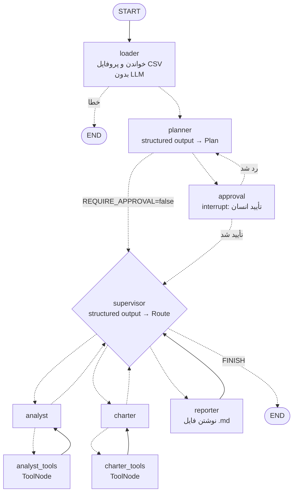

# CSV Insight Agent

یک ایجنت چندعاملی (multi-agent) با **LangGraph** که یک فایل CSV و یک سؤال می‌گیرد،
خودش نقشهٔ تحلیل می‌کشد، با pandas عدد درمی‌آورد، نمودار می‌سازد و یک گزارش
Markdown می‌نویسد.

این پروژه به‌عنوان **پروژهٔ پایانی دورهٔ LangGraph در freeCodeCamp** نوشته شده و
عمداً یک پله فراتر از دوره است. راهنمای بازنویسی گام‌به‌گام در
[`PRACTICE.md`](PRACTICE.md) است — اگر هدفتان تمرین است، از همان‌جا شروع کنید،
نه از این فایل.

اگر فقط ده دقیقه وقت دارید، بخش
[«هجده درس که فقط از خرابی بیرون می‌آید»](PRACTICE.md#هجده-درس-که-فقط-از-خرابی-بیرون-میآید)
را بخوانید. آن هجده مورد، باگ‌های واقعی همین پروژه بودند: مسیر خوش‌بینانه
بی‌عیب کار می‌کرد و تست‌ها سبز بودند، تا وقتی کسی پرسید «اگر این نود خطا بدهد
چه می‌شود؟». چهارتای اول اگر با مدل واقعی اجرا می‌شد هزاران فراخوانی پولی
هزینه داشت؛ پنجمی وقتی پیدا شد که کاربر پروژه را روی ماشین خودش اجرا کرد.

---

## شروع سریع

راه‌اندازی قدم‌به‌قدم با خروجی مورد انتظار هر مرحله و رفع اشکال، در
[`RUNBOOK.md`](RUNBOOK.md) است. خلاصه‌اش:

```bash
python -m venv .venv && source .venv/bin/activate   # ویندوز: .venv\Scripts\activate
pip install -r requirements.txt

cp .env.example .env        # کلید API را داخلش بگذارید
```

اجرا:

```bash
# با OpenAI (پیش‌فرض)
python main.py data/sales.csv "کدام منطقه بیشترین درآمد را دارد و روند صعودی است؟"

# با Claude
python main.py data/sales.csv "..." --provider anthropic

# بدون تأیید انسانی (غیرتعاملی)
python main.py data/sales.csv "..." --no-approval

# بدون هیچ کلید API — با مدل اسکریپت‌شده، برای دیدن جریان گراف
python main.py data/sales.csv "..." --provider fake
```

**مدل باید tool calling و structured output داشته باشد**، وگرنه نودهای
analyst و charter کار نمی‌کنند. سنجش قابلیت‌های مدل، قبل از اولین اجرای واقعی:

```bash
python check_llm.py        # چت ساده، structured output، tool calling
```

نتیجهٔ هر اجرا در پوشهٔ خودش می‌نشیند: `outputs/runs/<thread>/` — گزارش
`report_<timestamp>.md`، نمودارهای PNG، و `meta.json` (سؤال، کاربر، وضعیت، توکن‌ها).

تست‌ها (بدون نیاز به کلید API و بدون شبکه):

```bash
pytest          # ۲۴۳ تست (`pytest -rs` می‌گوید اگر چیزی skip شد، چرا)
```

نقشهٔ گراف:

```bash
python draw_graph.py            # متن Mermaid → mermaid.live
python draw_graph.py --png      # outputs/graph.png
```

---

## اپ وب (برای شما و همکاران)

همان ایجنت، در مرورگر: فایل CSV را بالا می‌گذارید، سؤال می‌پرسید، نقشه را
تأیید یا اصلاح می‌کنید، و گزارش را با نمودارهایش همان‌جا می‌خوانید و دانلود
می‌کنید.

```bash
python run_app.py          # ویندوز: یا روی run_app.bat دوبار کلیک کنید
```

مرورگر خودش باز می‌شود (`http://localhost:8501`).

- **بدون `APP_PASSWORD` در `.env`:** فقط همین کامپیوتر به اپ دسترسی دارد.
- **با `APP_PASSWORD` (حداقل ۸ حرف):** همکاران در شبکهٔ دفتر با آدرسی که
  `run_app.py` چاپ می‌کند (مثل `http://192.168.1.23:8501`) و این رمز وارد
  می‌شوند. ویندوز اولین بار می‌پرسد Python به شبکه دسترسی داشته باشد یا نه:
  فقط **Private** را تیک بزنید.

چه چیزهایی دارد:

- هر اجرا در پوشهٔ خودش — دو نفر هم‌زمان نمودارهای هم را رونویسی نمی‌کنند.
- اجرا در پس‌زمینه است: می‌شود صفحه را بست و بعداً از فهرست **Runs** برگشت.
- دکمهٔ **Stop** (بعد از قدم جاری) و **Continue** (از آخرین قدم تمام‌شده).
- اگر اپ وسط اجرا بسته شد، اجرا با **Continue** از همان‌جا ادامه می‌دهد.
- دانلود گزارش (`.md`) یا همه‌چیز (`.zip`: گزارش، نمودارها، دادهٔ پاک‌شده).
- مصرف توکن هر اجرا و هر نفر؛ فهرست کامل در `outputs/usage.csv`. (این فایل را در اکسل باز نگه ندارید: اکسل قفلش می‌کند و مصرفِ اجراهای آن مدت ثبت نمی‌شود. برای دیدنش یک کپی از آن را باز کنید.)
- فایل CSV اکسل آلمانی (با `;` و اعشار با کاما) مستقیم خوانده می‌شود.

داده از کامپیوتر شما بیرون نمی‌رود، جز چیزی که به‌هرحال برای مدل فرستاده
می‌شود (پروفایل داده و خروجی ابزارها، نه کل فایل). آمار استفادهٔ Streamlit
خاموش است (`.streamlit/config.toml`).

---

## چه چیزی آزمایش شده و چه چیزی نه

صریح می‌گویم، چون فرقش برای شما مهم است:

**آزمایش‌شده و کار می‌کند**

- ۲۴۳ تست سبز، با مدل اسکریپت‌شده — بدون شبکه و بدون کلید API؛ و مستقل از
  `.env` شما (با یک `.env` واقعی هم آزمایش شد)
- اجرای کامل CLI با `--provider fake`: pandas واقعی، فایل PNG واقعی، گزارش
  Markdown واقعی، و checkpoint واقعی SQLite
- توقف در یک پروسه و ادامه در پروسه‌ای دیگر (`interrupt()` + `Command(resume=...)`)
- ساخته‌شدن کلاینت OpenAI و Anthropic با مدل درست هر کدام
- همهٔ ابزارها روی `data/sales.csv` واقعی
- pyflakes تمیز، و `pip install -r requirements.txt` قابل نصب
- **ویندوز ۱۱ + پایتون ۳.۱۴ با gpt-5.6-terra**: اجراهای واقعی توسط کاربر،
  تا گزارشی که همهٔ عددهایش با محاسبهٔ دستی می‌خواند
- اپ وب: ورود با رمز، آپلود، تأیید نقشه، Stop/Continue، دو اجرای هم‌زمان با
  نمودارهای جدا — با تست‌های Streamlit و یک مرورگر واقعی (Chromium)

**آزمایش‌نشده — چون کلید API نداشتم**

- یک اجرای واقعی با OpenAI یا Claude. سیم‌کشی گراف آزمایش شده، ولی **کیفیت
  promptها** نه: این‌که مدل واقعاً نقشهٔ خوبی بکشد، findingهای درست دربیاورد،
  و بخش Caveats را جدی بگیرد — این‌ها را باید خودتان با اولین اجرا ببینید.
  انتظار داشته باشید promptها در `src/prompts.py` کمی تنظیم لازم داشته باشند؛
  این کار طبیعیِ ساختن ایجنت است، نه نقص پروژه.
- اپ وب با چند کاربر هم‌زمان روی یک کامپیوتر آزمایش شده (تست‌ها + مرورگر
  واقعی)، ولی نه با ده‌ها نفر. برای یک تیم کوچک طراحی شده، نه برای سرور.
- **نام مدل‌ها تاریخ انقضا دارند.** `gpt-4o-mini` که پیش‌فرض اولیهٔ این پروژه
  بود، ظرف چند ماه از فهرست OpenAI حذف شد و یک checkout تازه با
  «model not found» شکست می‌خورد — به دلیلی که هیچ ربطی به کد ندارد.
  پیش‌فرض‌های امروز `gpt-6-luna` و `claude-sonnet-5` هستند و آن‌ها هم روزی
  کهنه می‌شوند. همه‌شان در `DEFAULT_MODELS` در `src/config.py` جمع‌اند و با
  `LLM_MODEL` قابل override؛ `python check_llm.py` در چند ثانیه می‌گوید
  نام فعلی کار می‌کند یا نه.

---

> **یادداشت:** پشتیبانی از Ollama در نسخهٔ ۰.۱۰.۰ حذف شد تا پروژه ساده بماند.
> چند درس در `PRACTICE.md` از اجراهای واقعی روی یک مدل محلی بیرون آمدند و
> همچنان معتبرند — آن‌ها دربارهٔ رفتار مدل‌اند، نه دربارهٔ provider. برای
> برگرداندنش کافی است یک شاخه در `src/llm.py` اضافه کنید؛ کل پروژه فقط از
> همان یک تابع مدل می‌گیرد.

---

## معماری



الگو **supervisor / worker** است: یک نود مسیریاب، سه کارگر تک‌منظوره.

| نود | LLM؟ | کارش |
|---|---|---|
| `loader` | ❌ | خواندن CSV، ساختن پروفایل (ستون‌ها، dtype، بازه‌ها، nullها) |
| `planner` | ✅ structured | تبدیل سؤال به ۳ تا ۶ قدم مشخص |
| `approval` | ❌ | `interrupt()` — انسان نقشه را تأیید یا اصلاح می‌کند |
| `supervisor` | ✅ structured | هر نوبت یک کارگر انتخاب می‌کند، یا پایان |
| `analyst` | ✅ + tools | حلقهٔ ReAct با ۵ ابزار pandas |
| `charter` | ✅ + tools | ساختن نمودار با matplotlib |
| `reporter` | ✅ | نوشتن گزارش Markdown روی دیسک |

---

## چه چیزی از دوره است و چه چیزی اضافه شده

آنچه در دوره دیدید و اینجا هم هست: `StateGraph`، `TypedDict` برای state،
`add_messages`، نودها و یال‌های شرطی، حلقه، `ToolNode`، حافظه با checkpointer،
الگوی ReAct، و RAG-مانند بودن reporter (تولید از روی شواهد جمع‌شده).

آنچه فراتر از دوره است:

| موضوع | کجا ببینید | چرا مهم است |
|---|---|---|
| الگوی supervisor/worker | `src/nodes/supervisor.py` | تعداد قدم‌های تحلیل از قبل معلوم نیست؛ فقط مدل می‌تواند در زمان اجرا تصمیم بگیرد |
| پیشرفت نقشه در state | `state.py:addressed_steps` | هر قدم `[done]`/`[pending]` است، وگرنه supervisor کار تمام‌شده را تکرار می‌کند |
| استخراج finding با schema | `nodes/analyst.py:_extract_finding` | مدل محلی قالب متنی را رعایت نمی‌کند؛ شیء تایپ‌دار تضمین می‌شود |
| `interrupt()` + resume | `src/nodes/approval.py` | توقف گراف، خروج از پروسه، و ادامه از همان نقطه — حتی روز بعد |
| checkpoint پایدار با SQLite | `src/graph.py:make_checkpointer` | خودِ «توقف» در دیتابیس ذخیره می‌شود، نه در RAM |
| structured output | `src/schemas.py` | مسیریابی با JSON معتبر، نه با پارس کردن متن آزاد |
| سندباکس برای کد تولیدی مدل | `src/sandbox.py` | سه لایه: اعتبارسنجی AST، namespace محدود، timeout |
| `InjectedState` در ابزارها | `src/tools/analysis.py` | مسیر فایل از schema ابزار حذف می‌شود، پس مدل نمی‌تواند مسیر اشتباه بسازد |
| مدیریت خطا به‌جای crash | `src/errors.py` | خطا تبدیل به *داده* در state می‌شود؛ supervisor دورش می‌زند |
| نرده‌های محافظ (guardrails) | `supervisor.py` + `route_from_analyst` | بودجهٔ قدم **داخل** هر حلقه، نه فقط در supervisor |
| پنجرهٔ پیام سالم | `src/messages.py` | بریدن بین `tool_calls` و `ToolMessage` باعث خطای provider می‌شود |
| streaming | `main.py:run` | دو حالت هم‌زمان: `updates` برای خط نتیجهٔ هر نود، `messages` به‌عنوان نشانگر زنده در نودهای کند |
| تعویض provider | `src/llm.py` | OpenAI / Claude با یک متغیر محیطی |
| تست گراف بدون کلید API | `tests/fake_llm.py` | مدل اسکریپت‌شده؛ پلامبینگ ایجنت را قطعی تست می‌کند |

---

## نسخهٔ LangGraph — مهم

دوره با **LangGraph 0.x** ضبط شده؛ این پروژه روی **LangGraph 1.2.11** نوشته و
تست شده است. تفاوت‌هایی که ممکن است گیجتان کند:

| در دوره | اینجا |
|---|---|
| `MemorySaver` | `InMemorySaver` (نام قدیمی هنوز alias است) |
| `interrupt_before=["node"]` در `compile()` | تابع `interrupt()` داخل خود نود |
| `graph.invoke(None, config)` برای ادامه | `graph.invoke(Command(resume=value), config)` |
| `SqliteSaver.from_conn_string(...)` | `SqliteSaver(sqlite3.connect(path, check_same_thread=False))` |

اگر می‌خواهید دقیقاً با نسخهٔ دوره کار کنید، در `requirements.txt` عدد را عوض
کنید — اما توصیه‌ام این است که با 1.x تمرین کنید، چون API فعلی همین است.

---

## ساختار پروژه

```
csv-insight-agent/
├── RUNBOOK.md               راه‌اندازی قدم‌به‌قدم (از اینجا شروع کنید)
├── CHANGELOG.md             چه چیزی در هر نسخه عوض شد، و آیا نصب مجدد لازم است
├── main.py                  CLI + streaming + حلقهٔ resume
├── app.py                   اپ وب (Streamlit)
├── run_app.py / run_app.bat اجرای اپ وب؛ تصمیم دربارهٔ دسترسی همکاران
├── .streamlit/config.toml   تنظیمات Streamlit (آمار استفاده خاموش)
├── check_llm.py             سنجش قابلیت‌های provider (قبل از اولین اجرا)
├── draw_graph.py            رندر گراف به Mermaid/PNG
├── data/sales.csv           دادهٔ نمونه (۴۲۵ سطر، با عیب‌های عمدی)
├── outputs/                 runs/<thread>/ برای هر اجرا، usage.csv، فایل checkpoint
├── src/
│   ├── config.py            تنظیمات، از متغیرهای محیطی
│   ├── llm.py               ساخت مدل، تعویض provider
│   ├── state.py             AgentState + reducerها
│   ├── schemas.py           مدل‌های Pydantic برای structured output
│   ├── prompts.py           promptهایی که شما تنظیم می‌کنید (پچ‌ها دست نمی‌زنند)
│   ├── internal_prompts.py  promptهایی که کد به آن‌ها وابسته است — تنظیم نکنید
│   ├── budget.py            تقسیم بودجهٔ قدم‌ها (سهم هر قدم، رزرو نمودار)
│   ├── formatting.py        نوشتن عدد و کلید خالی برای مدل (یک قاعده، یک جا)
│   ├── dataset.py           بارگذاری و پروفایل CSV (بدون LLM)
│   ├── sandbox.py           اجرای امن کد pandas تولیدشده
│   ├── messages.py          پنجرهٔ امن پیام‌ها
│   ├── errors.py            دکوراتور safe_node
│   ├── tools/
│   │   ├── analysis.py      ۵ ابزار pandas
│   │   └── charts.py        ابزار نمودار
│   ├── nodes/               یک فایل به‌ازای هر نود
│   ├── graph.py             سیم‌کشی گراف + checkpointer
│   ├── runner.py            شروع/ادامهٔ اجرا، meta.json، توکن‌ها — مشترک CLI و اپ
│   └── jobs.py              اجرای پس‌زمینه برای اپ وب
└── tests/                   ۲۴۳ تست، هیچ‌کدام به کلید API نیاز ندارند
```

---

## دادهٔ نمونه

`data/sales.csv` عمداً کامل نیست. داخلش کار گذاشته شده:

- ۵ سطر تکراری
- nullها در `delivery_days` و `channel`
- یک سطر با `revenue` صد برابر (اشتباه تایپی شبیه‌سازی‌شده) که همبستگی
  `units ~ revenue` را نابود می‌کند
- یک اثر واقعی و قابل‌کشف: منطقهٔ North سفارش‌های بزرگ‌تری دارد
- یک روند صعودی واقعی در طول سال

هدف این است که بخش «Caveats» گزارش حرفی برای گفتن داشته باشد. ایجنتی که این‌ها
را نبیند و با اطمینان گزارش بدهد، همان حالت خطرناکی است که باید یاد بگیرید
تشخیص بدهید.

---

## تنظیمات

همه از `.env` خوانده می‌شود (نمونه در `.env.example`):

| متغیر | پیش‌فرض | کار |
|---|---|---|
| `LLM_PROVIDER` | `openai` | `openai` / `anthropic` / `fake` |
| `LLM_MODEL` | بسته به provider | نام مدل |
| `REQUIRE_APPROVAL` | `true` | توقف برای تأیید انسانی نقشه |
| `REQUIRE_CHART` | `true` | هر گزارشی که finding دارد، حداقل یک نمودار می‌گیرد |
| `MAX_STEPS` | `30` | سقف نوبت‌های مدل در کل اجرا (supervisor + workerها) |
| `LLM_TIMEOUT` | `120` | ثانیه‌های انتظار برای یک درخواست مدل (بدون آن، پیش‌فرض SDK ده دقیقه بود) |
| `MAX_TOOL_ROUNDS` | `4` | نوبت‌هایی که یک worker برای **یک** قدم نقشه دارد؛ بعد از آن finding از آخرین خروجی ابزار استخراج می‌شود |
| `MAX_FAILURES` | `3` | مجموع خرابی نودها که در یک اجرا تحمل می‌شود |
| `CHECKPOINT_DB` | `outputs/checkpoints.sqlite` | `:memory:` برای غیرفعال‌کردن پایداری |
| `CODE_TIMEOUT` | `15` | ثانیه، سقف اجرای هر قطعه کد |
| `MAX_ROWS_TO_MODEL` | `20` | سقف سطرهایی که ابزار به مدل نشان می‌دهد |
| `APP_PASSWORD` | خالی | خالی: اپ وب فقط روی همین کامپیوتر. پر (۸+ حرف): همکاران با این رمز از شبکه وارد می‌شوند |
| `OUTPUT_DIR` | `outputs/` | محل اجراها، گزارش‌ها، نمودارها و `usage.csv` |

---

## هشدار امنیتی

`src/sandbox.py` جلوی خطای *تصادفی* مدل را می‌گیرد، نه حملهٔ عمدی. هیچ سندباکس
in-process در پایتون مرز امنیتی واقعی نیست. اگر روزی این را جایی می‌گذارید که
ورودی‌اش از کاربر ناشناس می‌آید، اجرای کد باید داخل کانتینر یا سرویس جدا باشد.
این در خود فایل هم نوشته شده — بخوانیدش، لایه‌بندی‌اش بخش آموزندهٔ پروژه است.

**اپ وب:** هر کس رمز `APP_PASSWORD` را دارد، در عمل می‌تواند از طریق مدل روی
کامپیوتر شما کد pandas اجرا کند (سؤال به مدل می‌رسد و مدل کد می‌نویسد). رمز را
فقط به همکاران مورد اعتماد بدهید، اپ را روی شبکهٔ عمومی باز نکنید، و هزینهٔ همهٔ
اجراها از کلید API شماست — `outputs/usage.csv` می‌گوید چه کسی چقدر مصرف کرده.

---

## رفع اشکال

**`FrozenInstanceError` در تست‌ها** — `Settings` عمداً immutable است؛ از فیکسچر
`override_settings` در `tests/conftest.py` استفاده کنید، نه از `monkeypatch.setattr`
روی خود آبجکت.

**`tool_use ids must have matching tool_result blocks`** — پنجرهٔ پیام یک
`ToolMessage` را از `AIMessage` متناظرش جدا کرده. `src/messages.py:window` را ببینید.

**`InvalidUpdateError: at key 'x'`** — دو نود موازی یک کلید بدون reducer را
می‌نویسند. در `src/state.py` برایش reducer بگذارید.

**اسکریپت مدل fake تمام شد (`ScriptEmpty`)** — گراف بیشتر از آنچه اسکریپت
پیش‌بینی کرده LLM صدا زده. یعنی مسیر عوض شده؛ اسکریپت تست را با مسیر جدید
هم‌تراز کنید.

**`interrupt()` کار نمی‌کند** — گراف بدون checkpointer کامپایل شده. بدون
checkpointer، توقف جایی برای ذخیره‌شدن ندارد.

**`Unsupported value: 'temperature' does not support 0.0 with this model`** —
بعضی مدل‌های جدید فقط مقدار پیش‌فرض خودشان را قبول می‌کنند. از نسخهٔ ۰.۱۰.۲
کد خودش این ۴۰۰ را می‌شناسد، `temperature` را کنار می‌گذارد و یک بار دوباره
تلاش می‌کند؛ فقط یک خط `note:` می‌بینید. برای اینکه همان یک خط هم نیاید،
در `.env` بنویسید `LLM_TEMPERATURE=` (خالی).

**`Function tools with reasoning_effort are not supported`** — مدل
reasoning پیش‌فرض خودش را با ابزار ترکیب نمی‌کند. از ۰.۱۰.۳ کد روی
فراخوانی‌های ابزاردار (analyst، charter) `reasoning_effort=none` می‌فرستد و
یک خط `note:` چاپ می‌کند؛ planner و supervisor reasoning خود را نگه می‌دارند.

**`stopped at [analyst]: the model API refused the request`** — خطایی که
تکرار درستش نمی‌کند (کلید، نام مدل، پارامتری که مدل نمی‌پذیرد). اجرا عمداً
می‌ایستد به‌جای اینکه بودجهٔ خطا را خرجش کند. پیام می‌گوید احتمالاً چه چیزی
را درست کنید؛ بعد با `--resume --thread-id ...` از همان نود ادامه دهید.

**`The plan needs your approval, but this terminal cannot ask`** (کد خروج ۴) — خروجی را pipe کرده‌اید (`| Select-String`) یا ورودی کیبورد نیست. اجرا ذخیره شده است. بدون pipe بزنید `python main.py --resume --thread-id ...` تا نقشه را تأیید کنید، یا از اول با `--no-approval` اجرا کنید.

**`thread '...' already holds a run`** — با `--thread-id` تکراری سؤال **جدید** پرسیده‌اید. قبلاً گزارش قبلی برمی‌گشت. برای ادامهٔ همان اجرا `--resume` بزنید، برای سؤال جدید `--thread-id` را حذف کنید.

**`error in the settings (.env or environment): ...`** — یک مقدار در `.env` قابل استفاده نیست؛ پیام نام تنظیم و شکل درست را می‌گوید. `.env` با هر encodingی که ویندوز ذخیره کند (UTF-8، UTF-8 با BOM، UTF-16) خوانده می‌شود، و فقط `.env` کنار `main.py` — نه فایل پوشهٔ والد.

**کدهای خروج:** `0` گزارش نوشته شد · `1` گزارش نوشته نشد · `2` ورودی یا تنظیم نادرست · `3` مدل درخواست را رد کرد · `4` نقشه منتظر تأیید است · `130` Ctrl+C.

**`UnicodeEncodeError: 'charmap' codec can't encode character`** — فقط وقتی خروجی را pipe یا redirect می‌کنید (`| Select-String`، `> run.log`) روی ویندوز. از ۰.۱۱.۲ کاراکتری که در code page نیست به `?` تبدیل می‌شود و اجرا ادامه پیدا می‌کند.

**`PydanticSerializationUnexpectedValue ... field_name='parsed'`** — هشدار
بی‌خطر خود langchain-openai در structured output. از ۰.۱۰.۳ پنهان است؛ با
`--verbose` دوباره دیده می‌شود.
