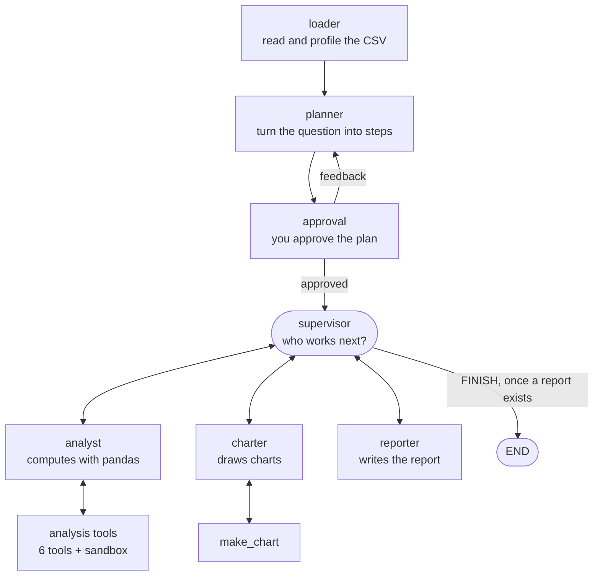

# CSV Insight Agent

**English** · [فارسی](README.fa.md)

An AI agent that answers business questions about a CSV file. You give it a file and a question. It makes a plan, computes the numbers with pandas, draws charts and writes a Markdown report.

```
python main.py data/sales.csv "Which region drives revenue, and is it growing?"
```

The model decides *what* to compute. The code does the computing, and it enforces the rules a report must follow. Every number in a report comes from a pandas call that you can trace, not from the model's memory.

Built with [LangGraph](https://github.com/langchain-ai/langgraph). It works with OpenAI or Anthropic models, from the command line or in a browser.

---

## Contents

- [What you get](#what-you-get)
- [How it works](#how-it-works)
- [Quick start](#quick-start)
- [Web app](#web-app)
- [Command line](#command-line)
- [Configuration](#configuration)
- [Data, privacy and security](#data-privacy-and-security)
- [Project structure](#project-structure)
- [Testing](#testing)
- [Troubleshooting](#troubleshooting)
- [LangGraph version](#langgraph-version)
- [Further documentation](#further-documentation)

---

## What you get

For each question, the agent writes one run folder, `outputs/runs/<run-id>/`, containing:

| File | Content |
| --- | --- |
| `report_<time>.md` | The report: summary, findings with their evidence, charts, caveats |
| `*.png` | The charts the report refers to |
| `working_*.csv` | The cleaned data, if the agent cleaned it (duplicates removed, wrong values fixed) |
| `meta.json` | Question, user, model, status and token usage |

What makes the reports reliable:

- **Numbers are computed, never recalled.** A finding is only recorded when a tool produced the numbers behind it.
- **Cleaning is verified.** If the agent removes or corrects rows, the code compares the data before and after and lists what actually changed. The report uses that list, not the model's own account.
- **You approve the plan.** The run pauses after planning. You approve the plan or say what to change.
- **Every report has a chart**, and a chart is always drawn from the same (cleaned) data as the numbers.
- **Budgets are hard limits.** A run can never loop forever or spend more model calls than `MAX_STEPS`.
- **German Excel files work as they are.** Semicolons as separators, decimal commas, dates like `13.02.2025` and the Windows `cp1252` encoding are all read correctly.

---

## How it works

The agent is a graph of small steps ("nodes"). A **supervisor** sits in the middle and picks the next worker on every turn.



| Node | What it does | Model call? |
| --- | --- | --- |
| `loader` | Reads the CSV, detects dates, builds a short data profile | No |
| `planner` | Writes a 3–6 step analysis plan (structured output) | Yes, once |
| `approval` | Pauses the run until a person approves the plan | No |
| `supervisor` | Chooses the next worker. Code checks and corrects the choice | Yes, per turn |
| `analyst` | Calls pandas tools until it can state a finding | Yes, per turn |
| `charter` | Draws charts for the findings | Yes, per turn |
| `reporter` | Writes the report from the findings and charts | Yes, once |

### Analysis tools

| Tool | Purpose |
| --- | --- |
| `group_aggregate` | Sum, mean, count, etc. per group |
| `value_counts` | Frequency of each value in a column |
| `correlations` | Pearson correlations between numeric columns |
| `column_stats` | Descriptive statistics |
| `run_pandas` | Any pandas snippet, run inside a sandbox |
| `save_cleaned_data` | Replaces the working data with a cleaned version, for all later tools |

### Design rules

1. **A prompt asks; code guarantees.** Every rule that code can check is checked in code: the plan ends with a report step, no step is analysed more than twice, the reporter never runs before there is a finding, and every report gets a chart.
2. **Errors are data.** A failing node does not crash the run. The error goes into the state, and the supervisor works around it. Errors that a retry cannot fix (bad API key, unknown model, a refused request parameter) stop the run cleanly, and it can be resumed after the fix.
3. **Every loop has a counter.** The supervisor loop and each tool loop are bounded by the step budget.
4. **Checkpoints everywhere.** State is saved after every node (SQLite). A run can pause for approval, survive a restart and resume where it stopped.

---

## Quick start

**Requirements:** Python 3.10 or newer, and an OpenAI or Anthropic API key.

### 1. Install

Windows (PowerShell):

```powershell
python -m venv .venv
.venv\Scripts\activate
pip install -r requirements.txt
copy .env.example .env
```

macOS / Linux:

```bash
python -m venv .venv
source .venv/bin/activate
pip install -r requirements.txt
cp .env.example .env
```

### 2. Add your API key

Open `.env` and set:

```
LLM_PROVIDER=openai
OPENAI_API_KEY=sk-...
```

### 3. Check that everything works

```bash
pytest                                   # all tests, no API key or network needed
python main.py data/sales.csv "Which region drives revenue?" --provider fake   # a full run with a scripted model, free
python check_llm.py                      # checks that your real model supports tools and structured output
```

### 4. Run it for real

```bash
python main.py data/sales.csv "Which region drives revenue, and is it growing over time?"
```

`data/sales.csv` is a synthetic sample (425 orders) with deliberate problems: duplicate rows, one wrong value and empty cells. It is a good first test of whether the agent finds them.

---

## Web app

The same agent in a browser: upload a CSV, ask a question, approve the plan, and read the report with its charts.

```bash
python run_app.py        # Windows: or double-click run_app.bat
```

The browser opens at `http://localhost:8501`.

| `APP_PASSWORD` in `.env` | Who can open the app |
| --- | --- |
| empty (default) | Only this computer |
| set (8+ characters) | Everyone on the local network who has the password. The launcher prints the address to share |

Features:

- Runs continue in the background. You can close the tab and come back later.
- **Stop** (after the current step) and **Continue** (from the last finished step).
- A list of your runs, and optionally everyone's.
- Download the report (`.md`) or everything (`.zip`).
- Token usage per run and per user, also written to `outputs/usage.csv`.

On Windows the first start asks whether Python may use the network. Allow it for **private networks only**.

---

## Command line

```
python main.py <csv> "<question>" [options]
```

| Option | Effect |
| --- | --- |
| `--provider openai\|anthropic\|fake` | Use another provider for this run |
| `--model NAME` | Use another model for this run |
| `--no-approval` | Skip the plan approval |
| `--thread-id ID` | Name the run, so you can resume it later |
| `--resume --thread-id ID` | Continue a stopped or paused run |
| `--verbose` | Show debug logging |

Exit codes, for scripts:

| Code | Meaning |
| --- | --- |
| `0` | Report written |
| `1` | No report written, or no saved run found for `--resume` |
| `2` | Configuration problem (settings, API key, arguments) |
| `3` | The model API refused the request. Fix it, then `--resume` |
| `4` | The plan needs approval, but the terminal cannot ask (output is piped) |
| `130` | Stopped with Ctrl+C. `--resume` continues |

Other tools:

```bash
python check_llm.py          # test your model before the first real run
python draw_graph.py         # print the graph as Mermaid
python draw_graph.py --png   # save it as outputs/graph.png
```

---

## Configuration

All settings live in `.env` (see `.env.example`). Environment variables work too.

| Setting | Default | Meaning |
| --- | --- | --- |
| `LLM_PROVIDER` | `openai` | `openai`, `anthropic` or `fake` (scripted, for tests) |
| `LLM_MODEL` | per provider | Model name |
| `LLM_TEMPERATURE` | `0` | Leave empty to send no temperature (some models accept only their default) |
| `LLM_TIMEOUT` | `120` | Seconds to wait for one model request |
| `REQUIRE_APPROVAL` | `true` | Pause for plan approval |
| `REQUIRE_CHART` | `true` | Every report with findings gets at least one chart |
| `MAX_STEPS` | `30` | Model turns per run, all nodes together |
| `MAX_TOOL_ROUNDS` | `4` | Turns a worker gets for one plan step |
| `MAX_FAILURES` | `3` | Node failures tolerated per run before a partial report |
| `CHECKPOINT_DB` | `outputs/checkpoints.sqlite` | `:memory:` turns persistence off |
| `CODE_TIMEOUT` | `15` | Seconds per generated pandas snippet |
| `MAX_ROWS_TO_MODEL` | `20` | Rows a tool may show the model |
| `APP_PASSWORD` | empty | Web app: empty = this computer only; set = local network with password |
| `OUTPUT_DIR` | `outputs/` | Where runs, reports and `usage.csv` are written |

Boolean settings also accept `ja/nein` and `an/aus`. Each key must appear only once in `.env`; the agent warns about duplicates.

Model names change over time. If you get "model not found", set `LLM_MODEL` to a current model name.

---

## Data, privacy and security

**What leaves your computer.** The CSV file itself is never sent to the model. The model receives a data profile (column names and types, counts of empty cells, minimum, maximum and mean of numeric columns, and up to 8 distinct values of short text columns) and the outputs of the tools it calls (for example a table of revenue per region, at most `MAX_ROWS_TO_MODEL` rows). These go to the model provider you configured (OpenAI or Anthropic). Streamlit usage statistics are turned off in `.streamlit/config.toml`.

**What stays local.** Uploaded files, cleaned data, reports, charts, checkpoints and the usage log are all under `outputs/`, which is excluded from Git.

**The sandbox is not a security boundary.** `run_pandas` executes code that the model wrote. The sandbox blocks imports, file access, dangerous names and runaway loops, which stops accidental damage. It cannot stop a determined attacker. So:

- Give the web app password only to people you trust.
- Never expose the app to the internet or a public network.
- For untrusted users, run code execution in a container or a separate service.

**Costs.** All runs use the API key in `.env`. `outputs/usage.csv` records the tokens used per run and per user.

**Never commit `.env`.** It holds your API key and is listed in `.gitignore`.

---

## Project structure

```
csv-insight-agent/
├── main.py                 command line: run, pause, resume, exit codes
├── app.py                  web app (Streamlit)
├── run_app.py / .bat       starts the web app; decides local vs. network access
├── check_llm.py            checks a model's capabilities before the first run
├── draw_graph.py           renders the graph as Mermaid or PNG
├── data/sales.csv          synthetic sample data with deliberate problems
├── src/
│   ├── config.py           settings from .env, validated at start-up
│   ├── llm.py              builds the model; repairs refused request parameters
│   ├── state.py            the shared state and how each key is merged
│   ├── graph.py            nodes, edges and the SQLite checkpointer
│   ├── budget.py           how the step budget is shared out
│   ├── dataset.py          CSV reading (incl. German Excel), date detection, profile
│   ├── sandbox.py          safe execution of model-written pandas code
│   ├── errors.py           turns node errors into state; stops on unfixable ones
│   ├── messages.py         trims the conversation without breaking tool-call pairs
│   ├── runner.py           shared by CLI and web app: run folders, metadata, tokens
│   ├── jobs.py             background runs for the web app
│   ├── prompts.py          prompts you may tune
│   ├── internal_prompts.py prompts the code depends on (do not tune)
│   ├── schemas.py          Pydantic schemas for structured model output
│   ├── nodes/              one file per node
│   └── tools/              analysis tools and the chart tool
├── tests/                  243 tests; none needs an API key
└── outputs/                runs, reports, checkpoints (not in Git)
```

---

## Testing

```bash
pytest
```

The tests use a scripted model instead of a real one, so they are fast, free and repeatable. They cover the whole graph (planning, approval, routing, budgets, failures, resume), the sandbox, the tools, Windows-specific file behaviour, German CSV files, two runs at the same time, and the web app (Streamlit `AppTest`).

On Windows, one test is skipped: the Ctrl+C test needs Unix signals. Expected result: `242 passed, 1 skipped` on Windows, `243 passed` on Linux and macOS.

---

## Troubleshooting

| Symptom | Likely cause and fix |
| --- | --- |
| `error: LLM_PROVIDER=openai needs OPENAI_API_KEY` | The key is missing from `.env`, or `.env` is not next to `main.py` |
| `model not found` | The model name is outdated. Set `LLM_MODEL` |
| A note about `temperature` or `reasoning_effort` | The model refused that parameter. The agent repaired the request and continued. Set `LLM_TEMPERATURE=` (empty) to skip the note |
| Exit code `4` | Output was piped (`\| Select-String`, `> file`). Run without the pipe, or add `--no-approval` |
| The CSV loads as one column | The file is neither comma- nor semicolon-separated. Save it again as CSV from Excel |
| Colleagues cannot open the web app | Set `APP_PASSWORD`, restart `run_app.py`, and allow Python in the Windows firewall for private networks |
| `ModuleNotFoundError` | The virtual environment is not active, or `pip install -r requirements.txt` was not run after an update |

---

## LangGraph version

This project is written and tested against **LangGraph 1.2.11**. Many tutorials, including the freeCodeCamp course it started from, use LangGraph 0.x. The differences you are most likely to meet:

| LangGraph 0.x | This project (1.x) |
| --- | --- |
| `MemorySaver` | `InMemorySaver` (the old name is still an alias) |
| `interrupt_before=["node"]` in `compile()` | `interrupt()` called inside the node |
| `graph.invoke(None, config)` to continue | `graph.invoke(Command(resume=value), config)` |
| `SqliteSaver.from_conn_string(...)` | `SqliteSaver(sqlite3.connect(path, check_same_thread=False))` |

---

## Further documentation

| Document | Content |
| --- | --- |
| [`RUNBOOK.md`](RUNBOOK.md) | Step-by-step setup, with the expected output of each step and what to do if it fails |
| [`PRACTICE.md`](PRACTICE.md) | A guide to rebuilding the project phase by phase, and eighteen lessons learned from real bugs |
| [`CHANGELOG.md`](CHANGELOG.md) | Every version: what changed, which files, and whether a reinstall is needed |

Each document also exists in Persian (`*.fa.md`).

---

## Tech stack

Python 3.10+ · LangGraph 1.2 · LangChain Core 1.6 · langchain-openai / langchain-anthropic · pandas · matplotlib · Pydantic · Streamlit 1.64 · SQLite · pytest

Exact versions are pinned in `requirements.txt`.

## Background

This project started as the capstone for the freeCodeCamp LangGraph course. It was then hardened through real runs with hosted models and a full code review; each fix is covered by a test.
