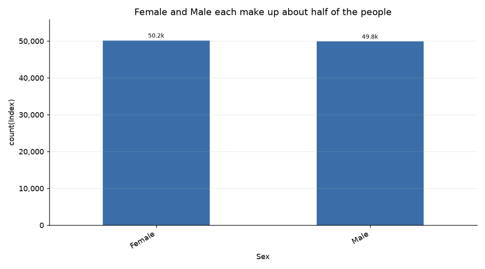

# سهم زن‌ها 50.152٪ و مردها 49.848٪ است

**Question.** درصد زن‌ها و مردها چقدر است؟

## Answer
زن‌ها (Female) 50.152٪ و مردها (Male) 49.848٪ از کل افراد هستند. تعداد رکوردها به‌ترتیب 50,152 و 49,848 است.

## What the data shows
- زن‌ها (Female): 50.152٪، معادل 50,152 رکورد؛ در یافته‌ای دیگر درصد با دقت کمتر 50.2% گزارش شده است.
- مردها (Male): 49.848٪، معادل 49,848 رکورد؛ در یافته‌ای دیگر درصد با دقت کمتر 49.8% گزارش شده است.

## Charts
  
نمودار سهم Female و Male را نشان می‌دهد.

## Caveats
در یافته‌ها درصدها هم با دقت سه رقم اعشار و هم با دقت یک رقم اعشار گزارش شده‌اند؛ ارقام بالا از گزارش دقیق‌تر انتخاب شده‌اند.