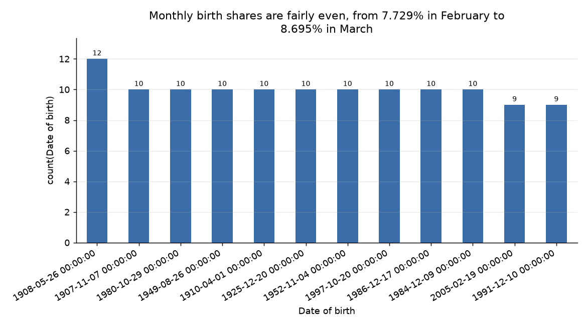

# Birth-date distribution is fairly even across months

**Question.** What percentage of people were born in each month?

## Answer
The chart shows the percentage of people born in each month in the provided dataset. Monthly percentages range from 7.729% in February to 8.695% in March.

## What the data shows
- Jan: 8.541%; Feb: 7.729%; Mar: 8.695%; Apr: 8.139%; May: 8.426%; Jun: 8.252%; Jul: 8.342%; Aug: 8.492%; Sep: 8.204%; Oct: 8.443%; Nov: 8.282%; Dec: 8.455%.
- All 100,000 `Date of birth` values were valid calendar dates; none were invalid or missing.

## Charts
  
Each bar shows the share of people born in that month.

## Caveats
The dataset provides percentages for its records; the supplied findings do not establish whether it represents a broader population.