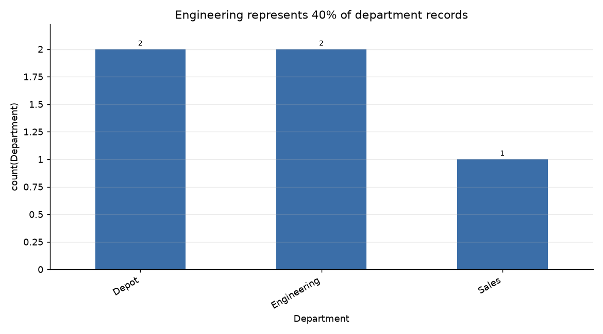

# Engineering represents 40% of departments

**Question.** What percentage of the departments are Engineering?

## Answer
Engineering accounts for **40%** of departments: **2 of 5 records**.

## What the data shows
- **5 records** have a non-null Department value.
- **2 of 5 records** are Engineering, representing **40%**.

## Charts
  
The chart shows Engineering’s share of departments.

## Caveats
The finding is based on **5 records** with non-null Department values.